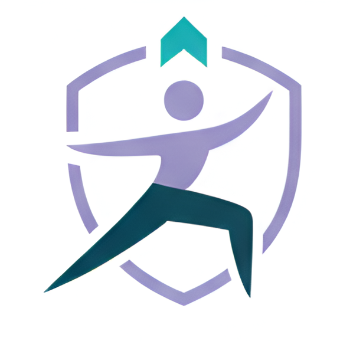

# 🧘 Pose Perfect (Posture Muse Guide)

<div align="center">



### **Master the Pose. Pose Yourself.**
*Next-generation, real-time AI yoga posture coach powered by on-device computer vision and natural voice guidance.*

</div>

---

## 🌟 Overview

**Pose Perfect** is an intelligent, privacy-first computer vision web application that transforms any webcam into a personal yoga instructor. Built with Google's **MediaPipe Pose Landmarker**, Pose Perfect tracks 33 3D skeletal landmarks in real time, computes anatomical joint angles, and delivers instant, spoken feedback alongside precision visual guidance.

All computer vision inference runs **100% locally in your browser** — no camera streams, images, or personal video data are ever uploaded to any external server or cloud service.

---

## ✨ Key Features

### 👁️ Real-Time On-Device Computer Vision
- **33 3D Landmark Tracking**: Continuous full-body skeletal detection using Google MediaPipe BlazePose (`pose_landmarker_full.task`).
- **Biomechanical Joint Analysis**: Live angular calculations across critical joints (knees, hips, elbows, shoulders, ankles, spine).
- **Hardware-Adaptive Inference**: Automatic GPU acceleration (WebGL/WebGPU) with seamless fallback to CPU for lower-powered devices.
- **100% Client-Side Privacy**: Zero network streaming of camera feeds; complete local processing via WebAssembly.

### 🎙️ Spoken Voice Coach & Motivational Feedback
- **Natural Voice Corrections**: Real-time voice cues via the browser-native Web Speech API (`SpeechSynthesis`) instructing you on posture adjustments (e.g., *"Straighten your left knee"*, *"Raise your arms higher"*).
- **Mid-Hold Motivational Boosts**: Dynamic encouragement during holds (*"Keep going, you can do it!"*, *"Stay strong!"*, *"Breathe deeply and hold steady"*).
- **Smart Speech Throttling**: Intelligent cooldown intervals prevent overlapping audio cues and maintain a calm practice flow.
- **Ambient Soundscapes**: Built-in soothing meditation background music during posture holds.

### 📊 Precision Multi-Metric Scoring Engine
Every session computes a multi-dimensional assessment:
- **Accuracy (0–100%)**: Weighted angular similarity against master yoga pose geometry.
- **Stability (0–100%)**: Time-series variance tracking how steadily you maintain the hold.
- **Symmetry (0–100%)**: Left-vs-right bilateral alignment to detect posture imbalances.
- **Overall Grade**: Dynamically scaled performance ratings (*Pose Master*, *Flowing Smoothly*, *Steady & Centered*, *Getting Stronger*).

### 🏆 Gamified Challenge & Practice Modes
- **5-Level Progressive Challenge**: Complete sequential pose challenges with timed holds, countdowns, and celebration animations:
  1. **Level 1**: Tree Pose (*Vrksāsana*) — Beginner balance
  2. **Level 2**: Warrior II (*Virabhadrāsana II*) — Intermediate strength & hip opening
  3. **Level 3**: Plank Pose (*Phalakāsana*) — Core stability
  4. **Level 4**: Triangle Pose (*Trikonāsana*) — Lateral spine & hamstring flexibility
  5. **Level 5**: Downward-Facing Dog (*Adho Mukha Śvānāsana*) — Full-body integration
- **Explore Poses Library**: Free-practice mode with 10+ curated postures (including Chair Pose, Warrior I, Cobra Pose, Child's Pose, and Bridge Pose).
- **Health Benefits & Alignment Tips**: Detailed breakdown of anatomical and mental benefits for every posture.

### 📄 One-Click Results & Report Export
- **Session Performance Summary**: Interactive visual scorecards showing overall percentage, stability, symmetry, and per-level performance.
- **Export to PDF & PNG**: Download your personalized yoga report card using HTML5 Canvas and jsPDF with zero cloud dependencies.
- **CORS-Resilient Rendering**: Gracefully handles remote thumbnails with offline fallbacks.

### 🎨 Cosmic Aurora Design System
- **Dark Glassmorphic UI**: High-contrast, elegant aesthetic with emerald, jade, and golden accents.
- **Fluid Micro-Interactions**: Silky 60 FPS state transitions powered by **Framer Motion**.
- **Responsive Layout**: Designed for seamless practice across laptops, desktops, and tablets.

---

## 🛠️ Tech Stack

| Layer | Technology | Description |
|---|---|---|
| **Frontend Framework** | React 18 + TypeScript | Modern component architecture with strict typing |
| **Build Tool & Dev Server** | Vite 7 | Lightning-fast HMR and optimized bundling |
| **Computer Vision / ML** | Google MediaPipe Tasks Vision | BlazePose 33-landmark on-device detection |
| **Styling & Components** | Tailwind CSS + Shadcn UI + Radix Primitives | Accessible, themeable UI components |
| **Motion & Animation** | Framer Motion 12 | Physics-based animations and screen transitions |
| **Audio & Speech** | Web Speech API + HTML5 Audio | Client-side speech synthesis and ambient sound |
| **Document Export** | jsPDF + HTML5 Canvas API | Client-side PDF and image report generator |
| **Icons** | Lucide React | Clean, lightweight SVG icons |

---

## 📂 Project Architecture

```
posture-muse-guide/
├── public/
│   ├── 1000130175-Picsart-AiImageEnhancer.png  # Application Banner & Logo
│   ├── meditation-relax-yoga-music.mp3         # Background Meditation Track
│   ├── placeholder.svg                         # Offline Image Fallback
│   ├── poses.json                              # 10 Poses + 5-Level Challenge Config
│   └── robots.txt
├── src/
│   ├── components/
│   │   ├── ui/                                 # 30+ Radix UI & Tailwind Components
│   │   ├── BenefitsCard.tsx                    # Anatomical & Wellness Benefits
│   │   ├── CameraView.tsx                      # Webcam Feed, MediaPipe & Skeleton Canvas
│   │   ├── ChallengeFlow.tsx                   # Challenge State Machine, Hold Timer & Voice Coach
│   │   ├── FinalSummary.tsx                    # Challenge Completion Analytics & PDF Export
│   │   ├── LevelCompleteOverlay.tsx            # Level Pass Modal & Animations
│   │   ├── NavLink.tsx                         # Navigation Link Component
│   │   ├── PoseCard.tsx                        # Pose Grid Item for Library Mode
│   │   └── SessionSummary.tsx                  # Post-Level Score Breakdown
│   ├── hooks/
│   │   ├── use-mobile.tsx                      # Viewport & Device Detection
│   │   └── use-toast.ts                        # Toast Notification Hook
│   ├── lib/
│   │   ├── reportGenerator.ts                  # Canvas & PDF Report Builder
│   │   └── utils.ts                            # Class Merging & Formatting Utilities
│   ├── pages/
│   │   ├── Index.tsx                           # Landing, Library & Challenge Router
│   │   └── NotFound.tsx                        # 404 Route Handler
│   ├── utils/
│   │   ├── angles.ts                           # 3D Vector Math & Anatomical Joint Angle Calculations
│   │   └── scoring.ts                          # Tolerance-Weighted Scoring, Stability & Symmetry
│   ├── App.tsx                                 # App Root & Providers (QueryClient, Toaster)
│   ├── index.css                               # Cosmic Aurora Theme & Tailwind Base
│   └── main.tsx                                # React DOM Entrypoint
├── package.json
├── tailwind.config.ts
├── tsconfig.json
└── vite.config.ts
```

---

## 🚀 Getting Started

### Prerequisites

Ensure you have the following installed:
- Node.js (v18.0.0 or higher; tested on v24.x)
- npm (v9.0.0 or higher) or Bun
- A working webcam (built-in or USB external)
- A modern web browser supporting WebGL and Web Speech API (Google Chrome, Microsoft Edge, Brave, or Firefox)

### Installation & Running

1. **Clone the repository**:
   ```bash
   git clone https://github.com/Dharaneeshsl/posture-muse-guide.git
   cd posture-muse-guide
   ```

2. **Install dependencies**:
   ```bash
   npm install
   ```

3. **Start the development server**:
   ```bash
   npm run dev
   ```

4. **Open in browser**:
   Navigate to `http://localhost:8080` in your web browser (or the URL displayed in your terminal).

---

## 💻 Available Scripts

| Script | Command | Purpose |
|---|---|---|
| **Development** | `npm run dev` | Runs the Vite development server on port 8080 with HMR |
| **Production Build** | `npm run build` | Compiles TypeScript and creates optimized `/dist` bundle |
| **Preview Build** | `npm run preview` | Starts a local web server to preview production build |
| **Lint** | `npm run lint` | Runs ESLint across all files |
| **Type Check** | `npx tsc --noEmit` | Validates TypeScript types across the project |

---

## 💡 How to Practice

1. **Launch**: Click **"Start Challenge"** to embark on the 5-level journey or **"Explore Poses"** to practice individual poses.
2. **Grant Camera Permissions**: Click "Allow" when the browser requests webcam access.
3. **Position Your Body**:
   - Stand approximately **6–8 feet (2–2.5 meters)** away from your webcam.
   - Ensure your whole body from head to feet is inside the frame.
   - Adequate, even room lighting helps tracking precision.
4. **Follow the Cues**:
   - Get into position during the 3-second preparation countdown.
   - Align your body with the live target posture.
   - Listen to real-time audio guidance to adjust your elbows, knees, or hips.
   - Hold steadily until the progress ring reaches 100%.
5. **Get Your Report**:
   - Review your Accuracy, Stability, and Symmetry scores.
   - Export your official session scorecard as a PDF or image.

---

## 🧮 Biomechanical Scoring Mechanics

The scoring engine evaluates posture accuracy in three dimensions:

$$\text{Total Score} = w_{\text{acc}} \cdot \text{Accuracy} + w_{\text{stab}} \cdot \text{Stability} + w_{\text{sym}} \cdot \text{Symmetry}$$

1. **Angular Accuracy**: Compares computed 3D vector joint angles (left/right knee, hip, shoulder, elbow) against ideal reference angles defined in `poses.json`. Each joint's error is normalized against its configured tolerance window:
   $$\text{Error} = \max\left(0, \frac{|\theta_{\text{actual}} - \theta_{\text{target}}| - \text{Tolerance}}{\text{Tolerance}}\right)$$
2. **Hold Stability**: Measures frame-to-frame angular variance over the holding window. Lower jitter yields higher stability scores.
3. **Bilateral Symmetry**: Measures balance between contralateral joint pairs (e.g., left vs. right hip and shoulder leveling).

---

## 🔒 Privacy & Security

- **100% Client-Side Inference**: Google MediaPipe executes directly inside your browser via WebAssembly and WebGL.
- **No Video Recording or Uploads**: Video frames are analyzed in memory and immediately discarded.
- **No External Analytics / Tracking**: Your practice remains completely private to you.

---

## 🛠️ Troubleshooting

- **Camera Not Loading**: Ensure camera permissions are granted in browser settings (`chrome://settings/content/camera`). Close any other apps using the webcam (e.g., Zoom, Teams).
- **Laggy Performance / Low FPS**: Ensure Hardware Acceleration is enabled in your browser settings (`Settings > System > Use graphics acceleration when available`).
- **Voice Feedback Not Playing**: Click anywhere on the webpage to activate browser audio permissions (browsers restrict auto-playing speech until user interaction).
- **Inference Fallback**: If WebGL/WebGPU is unavailable on your system, the application automatically falls back to CPU inference.

---

## 📄 License

This project is licensed under the MIT License.
